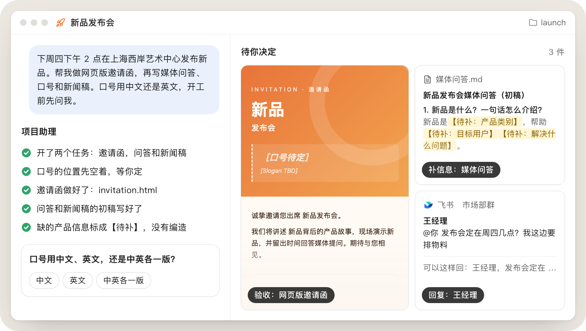
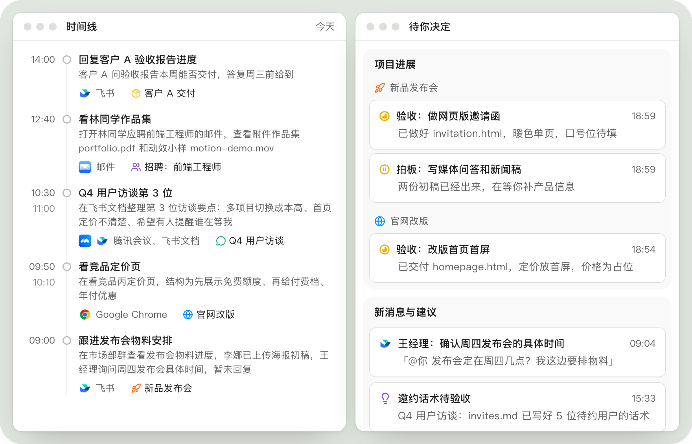
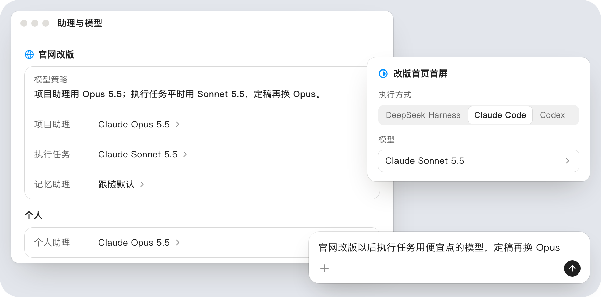
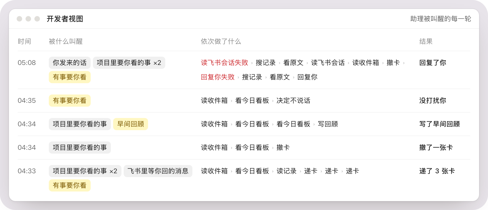

<h1 align="center">DS-buddy</h1>

<p align="center">Exploring the best way for people and AI to work together</p>

<p align="center"><a href="README.md">中文</a></p>



Over the past six months, one pain point has grown sharper for me: agents keep getting more capable, but people's efficiency hasn't kept pace. The same scene repeats: we run back and forth between several conversations, carrying context around, acting as the glue, and give up the time we need to think the direction through.

The problem isn't that AI isn't smart enough. It's that the bandwidth between people and AI is too narrow. DS-buddy wants to shape a new way of interacting that lowers the friction between people and AI.

**Most of the time, you don't need multiple agents. Managing agents is, at heart, managing context.**

The idea of an agent shouldn't be overused; most of the time a fork already does what we need. Many agent products carry the experience of organising people over to AI: open more and more agents, assign roles, set up channels, pass tickets along. It looks like collaboration, but at heart it still simulates a human meeting room, hoping that imitating people will lower the cost of communicating.

**The key to using AI well is to split the work into tasks that can be verified and have a clear goal: one goal and one loop at a time.**

DS-buddy deliberately has an agent maintain the organisation of each task: what the goal is, what counts as done, and where the context is are all written into the task. Add automations that run again on a schedule, and you can build your own task loops smoothly. Every core thread has a stable context.

**We don't need the concept of an agent. The runtime details and the dynamic, fragmented state should stay hidden.**

DS-buddy is built on the idea that an agent only needs to expose the model itself; every extra layer of agent is one more burden. Some will say that agents in products like Multica need Skills and runtimes configured, but that makes setup harder. These belong to the task's context in the broad sense: they shouldn't be preset, but should change with what the tasks in a project need. Of course, you can, and are encouraged to, give each project a rule for which models to prefer.

**You can do without the agent abstraction, but every runtime should stay visible.**

The abstraction shouldn't be a burden. Still, DS-buddy keeps every runtime observable: what woke it, the steps it took, and the result are all in the developer view.

**Take in as much context as possible, use the best model to assign the work, then let the AI explore.**

DS-buddy trusts, as far as it can, that giving the model enough context and letting it explore freely beats over-engineered prompts. What you do on screen is organised into a timeline, and everything that needs your call is on one board.

**A small suggestion: give the personal assistant the best model you can.**

The assistant that splits the work is the coordinator. Whether the tasks are divided sensibly, and at the right size, decides how smoothly everything after it runs. So we suggest the highest-quality model you can use for the personal assistant, such as Claude Opus 5.5 or GPT-6 Astra.

## How to use it

The interface is in Chinese for now; the pictures below show it as it is.

### 1. Install

You need DeepSeek Harness (tested on 0.2.1) and Node 24 or later. If you do not have DeepSeek Harness yet: `npm install -g @deepseek-ai/dsh`.

```sh
git clone https://github.com/DKKD13/tacit-dsh
cd tacit-dsh/plugin
dsh plugin --profile web add "$(pwd)"    # add the plugin to DeepSeek Harness
dsh --profile web                        # start it and open the address it prints
```

The sidebar gains a personal assistant and projects. The personal assistant is called Tacit by default, and it watches all your projects. With the Claude Code or Codex command line installed, tasks can be handed to them; with the Feishu command line (lark-cli) installed and authorised, Tacit can read your Feishu messages, read-only.

### 2. Hand over a job

Create a project; you can give it a folder for the executor to work in. In the project's conversation, say one sentence that covers three things: what to do, where the context is, and what counts as good. The project assistant starts what it can and asks about what you left unclear, as in the picture at the top.

Open a task to see its context: your own words, what counts as done, what it produced, the files it read, and its progress.

### 3. Accept and decide

Finished tasks, Feishu messages waiting for your reply and Tacit's own suggestions all land in Waiting on you. On a computer with Screenpipe, what you do on screen is organised into a timeline every 10 minutes, filed under a project when it is clear which one.



The cards have no buttons. Click a task card to open the task, where delivered pages, images and documents preview in place; accept it, or say exactly what to change. Click a message card and a whole request is written into the input box for you to edit and send.

### 4. Models and executors

Give a project a model strategy in one sentence: write it yourself, or just tell Tacit. Each task can switch its executor between DeepSeek Harness, Claude Code and Codex, and its model separately.



Claude Code and Codex run as executors without permission prompts or a sandbox: they can read and write whatever your OS user can.

### 5. Every run is visible

The developer view lists every time the assistant was woken: what woke it, the steps it took in order, which step failed, and what came of it.



### What you can tell Tacit

| You say | What it does |
| --- | --- |
| "Make me a project: hiring a front-end engineer" | Creates a project |
| "Give this to the hiring project: …" | Hands your own words to the project as written, which opens a task |
| "What's waiting for me?" "What happened today?" | Answers from the board and the timeline, each item with its source |
| "Tell the interview-questions task to add a CSS question" | Passes the message to that task |
| "Accept it" | Tells you what changed first, and accepts after you reply "confirm" |
| "Remember: I like to read the conclusion first" | Adds it to About you, with your words |
| "Use a cheaper model for this project from now on" | Records it as the project's model strategy, then switches models accordingly |

It doesn't send messages in your name. Without a word from you it makes no decision and accepts nothing.

### When something goes wrong

| What you see | What to do |
| --- | --- |
| The page says it can't reach the service and is reconnecting | The service stopped or is restarting. The page reconnects by itself when it is back. |
| A task stopped at failed | Open the task and read the last progress entry. It is usually a model or network error; tell it to carry on. |
| Nothing happens after switching to Codex | Codex has to be logged in on this machine first. |

## More

- [Introduction, full version](https://dkkd13.github.io/tacit-dsh/site/blog/en/): the long version of this introduction
- [Architecture](https://dkkd13.github.io/tacit-dsh/site/blog/en/deep/): how it is built
- [Product page](https://dkkd13.github.io/tacit-dsh/site/), [film](https://github.com/DKKD13/tacit-dsh/releases/latest/download/tacit-film.mp4)
- [Getting started](docs/GETTING-STARTED.md), [features](docs/FEATURES.md) and [test report](docs/TESTING.md) (Chinese)

## Where it stands

Version 1.0. It runs only inside DeepSeek Harness, the interface is in Chinese for now, and Feishu is read-only. Claude Code as an executor has been run for real. Codex can be selected, but a complete task run on it has not been verified yet. Both run without permission prompts or a sandbox: they can read and write whatever your OS user can.

License: [MIT](LICENSE).
