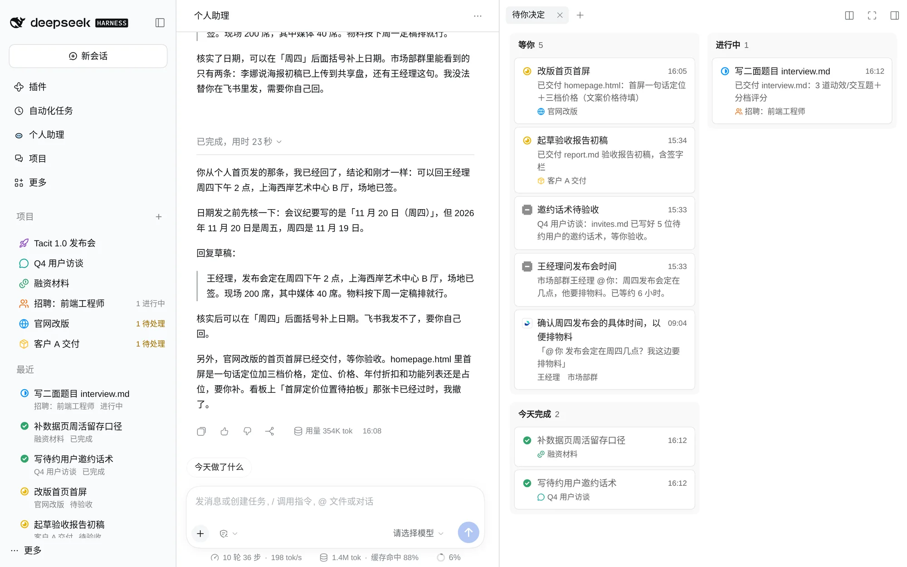

# Tacit

**Say one sentence. Tacit gets it.**

Tacit is a context layer inside DeepSeek Harness (DSH). It sorts what is scattered across your chats, projects, Feishu and computer by project and task, so every agent gets exactly the context it needs. You state the goal. You are called only when something needs your decision.

[中文](README.md)


Product page: [`docs/site/index.html`](docs/site/index.html) · 63-second film: [`https://github.com/DKKD13/tacit-dsh/releases/latest/download/tacit-film.mp4`](https://github.com/DKKD13/tacit-dsh/releases/latest/download/tacit-film.mp4)

## What it is

- A **personal assistant** watches all your projects, remembers what you said in your own words, and tells you when something waits on you.
- Each **project** has a project assistant. You say one thing; it asks what it must know, then opens tasks and hands them to executors. What can run in parallel does.
- **Executors** do the work: write documents, build pages, change code. Finished work goes to the project's shared files and waits for you to accept it.
- A small **pixel tile** in the corner shows what the assistant is doing: working, waiting on you, or done. ⌥M calls it up.

## How one request runs

| 1 It asks first | 2 You can see how it is going |
| --- | --- |
|  |  |
| You say “Tacit 1.0 launches next Thursday, make the invitation and the press Q&A”. It starts what it can, then asks about the palette and which Thursday you mean. | The task page: the brief with your own words, what counts as done, files read, progress by time, and who executes. |

| 3 Finished work comes back | 4 Everything that needs you, on one board |
| --- | --- |
|  |  |
| Web pages render in the panel, images show, documents preview. Accept, or ask for a change. | Waiting on you, running, done today. Cards have no buttons: click a task to open it, click a message and a reply is drafted in the input box. |

## Features

- **Decisions board.** One board across every project. Deliveries to accept, questions to answer, failed tasks, Feishu messages you have not replied to and the assistant's reminders all sit in the first lane.
- **Task page.** Brief, checklist, output, files read, timeline, executor and model. Take a task over yourself, then hand it back.
- **Decisions and acceptance.** When an executor needs a decision it shows an option card with the recommended choice marked. Accepting is always yours.
- **Swappable executors.** Each task runs on DSH by default. If Claude Code or Codex is on the machine, switch the task to it. What you type follows the task.
- **Memory with a source.** “About you” keeps only what you said yourself, each line with the original quote, and can be undone. Work memory carries its evidence.
- **A night pass.** When the computer is idle at night, the assistant reviews the day and leaves at most three items for the morning, each with its source, plus a one-page diary.
- **Assistants and models.** One page per assistant: when it wakes, what it reads each turn, which model it uses. A project's model strategy can be one sentence.
- **Read-only sources.** Feishu messages (read-only) and folders on your Mac you allow. Both can be switched off at any time.

## Quick start

Needs DSH 0.2.x with the web profile, and Node 24 or later.

```sh
git clone https://github.com/DKKD13/tacit-dsh
cd tacit-dsh/plugin && npm test          # 478 unit tests
dsh plugin --profile web add "$(pwd)"
dsh --profile web
```

After it opens, the sidebar shows 个人助理 (personal assistant) and 项目 (projects). The interface is in Chinese for now. Models follow your DSH settings.

A step-by-step guide (Chinese): [`docs/GETTING-STARTED.md`](docs/GETTING-STARTED.md).

## How it works

- Every assistant is an ordinary DSH session: one project assistant per project, one executor per task. You can open any of them and read the full trace.
- A wake carries only “how many unread, from where”. The agent reads its own inbox and confirms when the turn ends, so a lost wake never loses a message. We learned this from Raft.
- All state is one event log. The board, the task page and memory are computed from it.
- Code only validates: does the quoted line exist in that message, does the number come from the material. Meaning and wording stay with the model.

## Limits

- It never decides, accepts or sends messages on your behalf.
- Feishu is read-only. Mac folders are read-only, and only the ones you allow.
- It runs only inside DeepSeek Harness.
- Model keys stay on the machine that runs it and never enter the repository.

## More

- Features and what backs each one: [`docs/FEATURES.md`](docs/FEATURES.md)
- Test report: [`docs/TESTING.md`](docs/TESTING.md)
- How we benchmarked against Manus, Genspark and Raft: [`docs/launch/benchmark.md`](docs/launch/benchmark.md)

License: [MIT](LICENSE).
