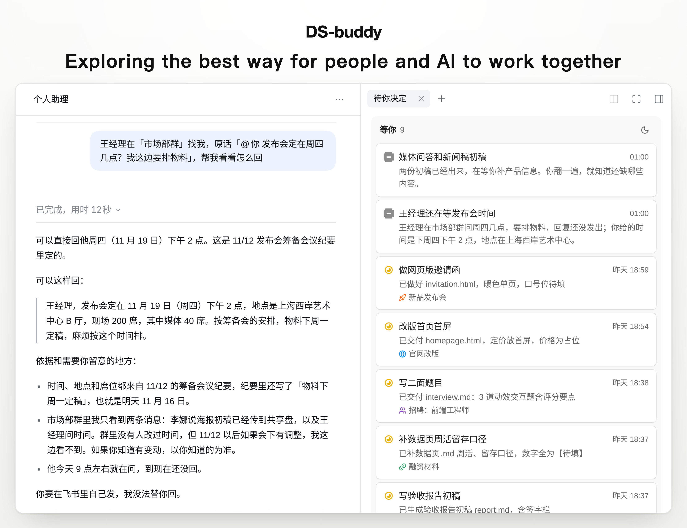
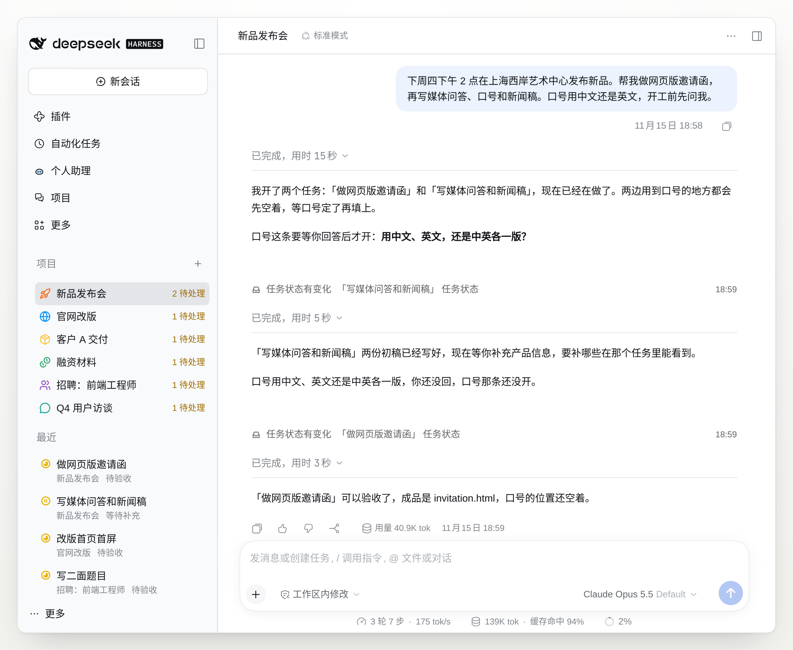
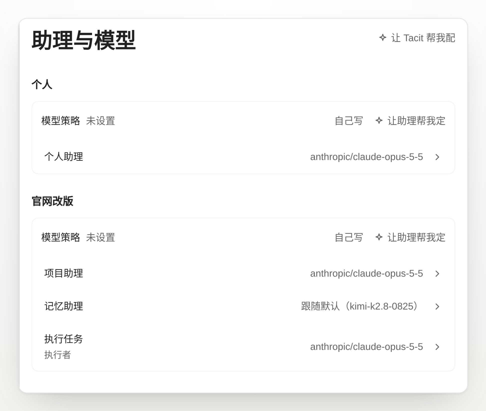
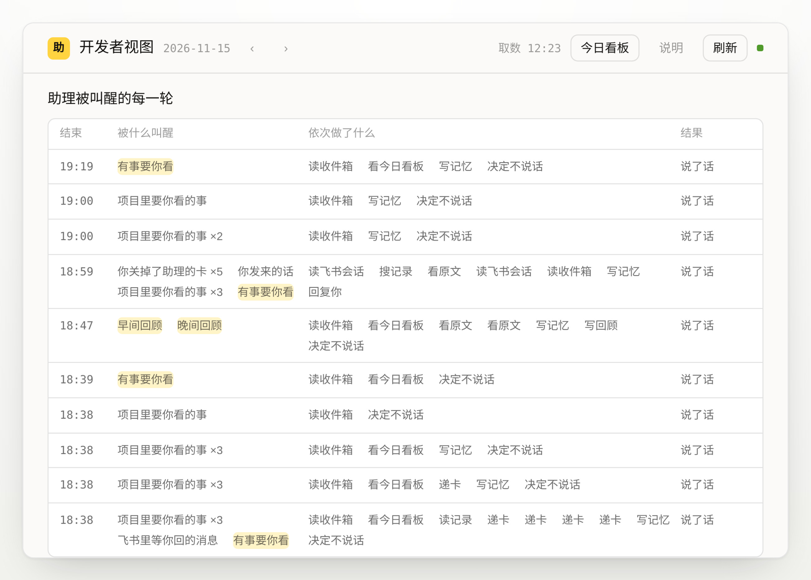
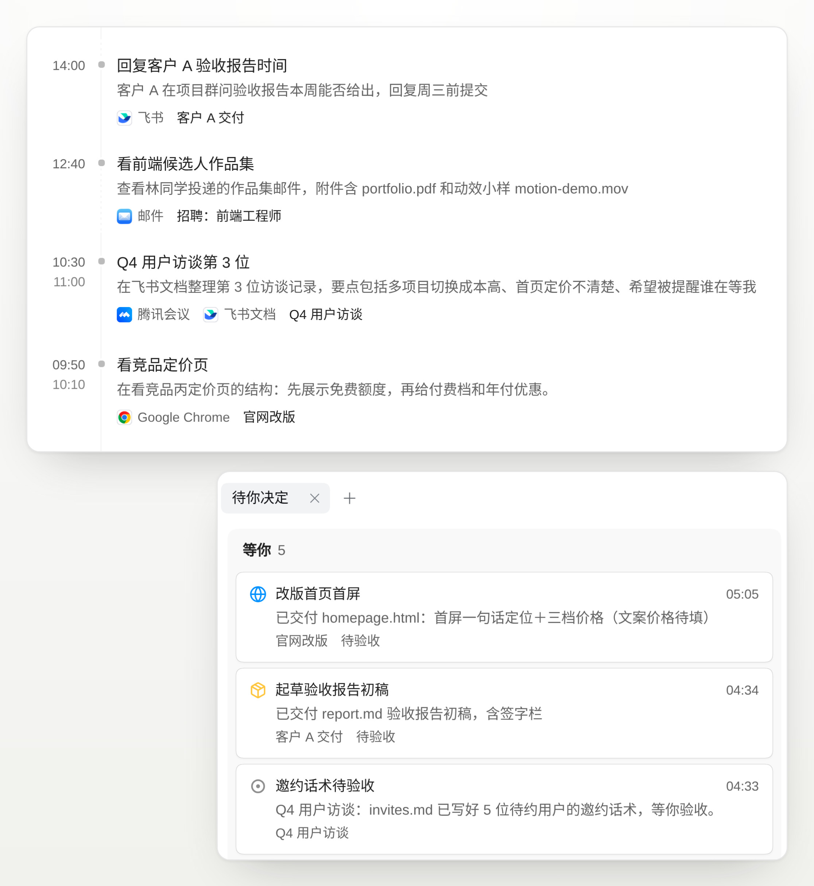

<p align="center"><a href="README.md">中文</a></p>

Over the past six months, one pain point has grown sharper for me: agents keep getting more capable, but people's efficiency hasn't kept pace. The same scene repeats: we run back and forth between several conversations, carrying context around, acting as the glue, and give up the time we need to think the direction through.

The problem isn't that AI isn't smart enough. It's that the bandwidth between people and AI is too narrow. DS-buddy wants to shape a new way of interacting that lowers the friction between people and AI.

**Most of the time, you don't need multiple agents. Managing agents is, at heart, managing context.**

The idea of an agent shouldn't be overused; most of the time a fork already does what we need. Many agent products carry the experience of organising people over to AI: open more and more agents, assign roles, set up channels, pass tickets along. It looks like collaboration, but at heart it still simulates a human meeting room, hoping that imitating people will lower the cost of communicating.

**The key to using AI well is to split the work into tasks that can be verified and have a clear goal: one goal and one loop at a time.**

DS-buddy deliberately has an agent maintain the organisation of each task: what the goal is, what counts as done, and where the context is are all written into the task. Add automations that run again on a schedule, and you can build your own task loops smoothly. Every core thread has a stable context.



**We don't need the concept of an agent. The runtime details and the dynamic, fragmented state should stay hidden.**

DS-buddy is built on the idea that an agent only needs to expose the model itself; every extra layer of agent is one more burden. Some will say that agents in products like Multica need Skills and runtimes configured, but that makes setup harder. These belong to the task's context in the broad sense: they shouldn't be preset, but should change with what the tasks in a project need. Of course, you can, and are encouraged to, give each project a rule for which models to prefer.

<p align="center"></p>

**You can do without the agent abstraction, but every runtime should stay visible.**

The abstraction shouldn't be a burden. Still, DS-buddy keeps every runtime observable: what woke it, the steps it took, and the result are all in the developer view.



**Take in as much context as possible, use the best model to assign the work, then let the AI explore.**

DS-buddy trusts, as far as it can, that giving the model enough context and letting it explore freely beats over-engineered prompts. What you do on screen is organised into a timeline, and everything that needs your call is on one board.

<p align="center"></p>

**A small suggestion: give the personal assistant the best model you can.**

The assistant that splits the work is the coordinator. Whether the tasks are divided sensibly, and at the right size, decides how smoothly everything after it runs. So we suggest the highest-quality model you can use for the personal assistant, such as Claude Opus 5.5 or GPT-6 Astra.

## Install

You need DeepSeek Harness (tested on 0.2.1) and Node 24 or later. If you do not have DeepSeek Harness yet: `npm install -g @deepseek-ai/dsh`.

```sh
git clone https://github.com/DKKD13/tacit-dsh
cd tacit-dsh/plugin
dsh plugin --profile web add "$(pwd)"    # add the plugin to DeepSeek Harness
dsh --profile web                        # start it and open the address it prints
```

The sidebar gains a personal assistant and projects. Create a project and state your first goal. Step by step: [the guide](https://dkkd13.github.io/tacit-dsh/site/blog/en/guide/).

## More

- [Introduction, full version](https://dkkd13.github.io/tacit-dsh/site/blog/en/): the long version of this introduction
- [Guide](https://dkkd13.github.io/tacit-dsh/site/blog/en/guide/): how to work with Tacit
- [Architecture](https://dkkd13.github.io/tacit-dsh/site/blog/en/deep/): how it is built
- [Product page](https://dkkd13.github.io/tacit-dsh/site/), [film](https://github.com/DKKD13/tacit-dsh/releases/latest/download/tacit-film.mp4)
- [Getting started](docs/GETTING-STARTED.md), [features](docs/FEATURES.md) and [test report](docs/TESTING.md) (Chinese)

## Where it stands

Version 1.0. It runs only inside DeepSeek Harness, the interface is in Chinese for now, and Feishu is read-only. Claude Code as an executor has been run for real. Codex can be selected, but a complete task run on it has not been verified yet. Both run without permission prompts or a sandbox: they can read and write whatever your OS user can.

License: [MIT](LICENSE).
