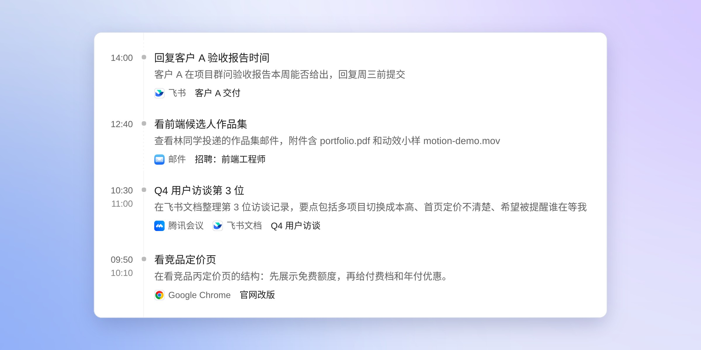
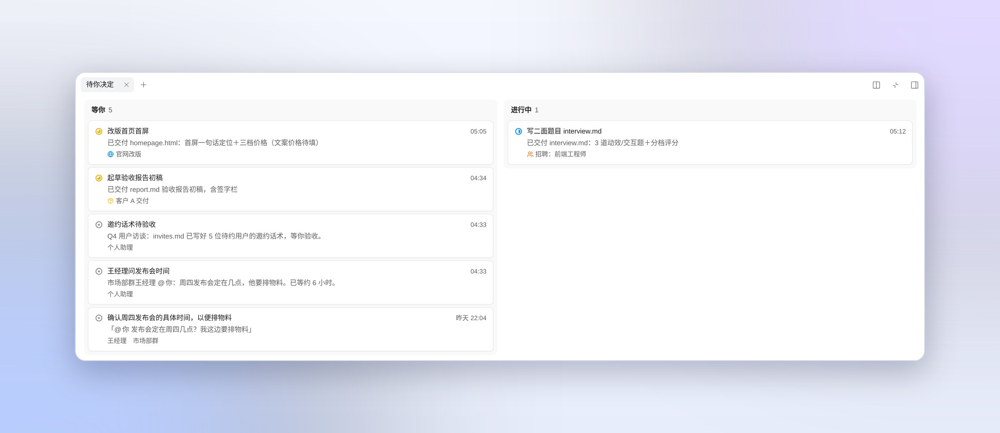

# DS-buddy: your next agent product may not need agents

**Exploring the best way for people and AI to work together.**

[Guide](https://dkkd13.github.io/tacit-dsh/site/blog/en/guide/) · [Architecture](https://dkkd13.github.io/tacit-dsh/site/blog/en/deep/) · [Product page](https://dkkd13.github.io/tacit-dsh/site/) · [Film](https://github.com/DKKD13/tacit-dsh/releases/latest/download/tacit-film.mp4) · [中文](README.md)

Agents keep getting more capable, and our own efficiency hasn't kept up. We run back and forth between several conversations, carrying context around, acting as the glue, with little time left to think the direction through.

The problem isn't that AI isn't smart enough. It's that the bandwidth between people and AI is too narrow. Context has to reach the AI, without using up people's attention to get it there.

Many agent products answer with more agents: assign roles, hold meetings, pass messages to each other.

We see it differently.

**Most of the time, you don't need multiple agents.** Managing agents is, at heart, managing context. A fork shares: the new branch is born with the main conversation's full context. Multiple agents pass things on: compress, retell, understand again, and every extra layer loses a little more. Messages passed between people get garbled, and so do messages between agents. Meeting-room multi-agent looks like collaboration, but it only moves the human way of organising onto models.

A fork alone isn't enough either. Context that grows naturally in a conversation gets dirtier: small talk, stale conclusions and the noise of work in progress all stay in and keep using up the model's attention. Compression alone can't save it.

**Context should be designed from the start.** AI needs a clear goal and acceptance criteria, so DS-buddy organises work around the goal, that is, the loop. You only need to make three things clear: what to do, where the context is, and what the standard is. The AI breaks that into tasks, and each task has its own context pack, which you can think of as a goal file. That file is what really needs maintaining over time: injected each time, updated each time. A task worth handing over doesn't have to be big, but it has to be complete and deliverable on its own.

The agents that do the work are just tools. Their state is fragile; they are thrown away after use and injected again next time. Add automated tasks that run again on a schedule, and your task loops keep turning by themselves.

**Hide the details, show the progress.** Multica and Raft organise agents through group chats and tickets, their underlying abstractions are well made, and we borrowed from their thinking. But setting up channels, configuring roles and dividing up the work is a burden for people in itself. How the context is assembled, at which layer the cache hits, how tokens are saved: that is all under the hood. Hiding it well also pays off: with the stable part at the front, the model can reuse what it read last time, and a cache hit and a cache miss differ in cost by an order of magnitude.

So in DS-buddy there are no agents to name and no skills to configure. But how far each job has got, and which model it went to, is always visible. Every task has a page of details, and whatever needs your call is on one board called Waiting on you.



**It understands before you speak.** For AI to take over carrying context, it first has to see enough of it. What you are doing on screen and the messages in Feishu keep coming in and are organised into a timeline every 10 minutes. Files on your computer are read when needed. All of it is read-only and can be turned off at any time.


Collecting context automatically isn't new: Screenpipe, AirJelly, Littlebird and the Computer History built into Codex have been doing it for a while. But most of them stop at collecting context and never get to action.

The core assistant in DS-buddy is called Tacit by default, meaning tacit understanding. A good buddy doesn't need you to spell everything out.

**A small suggestion: use the strongest model to split the work.** The most important link right now is the coordinator, the assistant that splits the work, and whether it gets the division and the size of tasks right. We recommend a strong model such as Claude Opus 5.5 or GPT-6 Astra for the personal assistant. As models get stronger and the skills for dividing work get refined, this keeps getting better.

People express preferences and give direction only where it matters, instead of carrying information around. The rest goes to the AI.

DS-buddy: your next agent product may not need agents.

Give it a try.

## Install

You need DeepSeek Harness (tested on 0.2.1) and Node 24 or later. If you do not have DeepSeek Harness yet: `npm install -g @deepseek-ai/dsh`.

```sh
git clone https://github.com/DKKD13/tacit-dsh
cd tacit-dsh/plugin
dsh plugin --profile web add "$(pwd)"    # add the plugin to DeepSeek Harness
dsh --profile web                        # start it and open the address it prints
```

The sidebar gains a personal assistant and projects. Create a project and state your first goal. Step by step: [the guide](https://dkkd13.github.io/tacit-dsh/site/blog/en/guide/).

## Docs

- [Guide](https://dkkd13.github.io/tacit-dsh/site/blog/en/guide/): how to work with Tacit
- [Architecture](https://dkkd13.github.io/tacit-dsh/site/blog/en/deep/): how it is built
- [Getting started](docs/GETTING-STARTED.md), [features](docs/FEATURES.md) and [test report](docs/TESTING.md) (Chinese)

## Where it stands

Version 1.0. It runs only inside DeepSeek Harness, the interface is in Chinese for now, and Feishu is read-only. Claude Code as an executor has been run for real. Codex can be selected, but a complete task run on it has not been verified yet. Both run without permission prompts or a sandbox: they can read and write whatever your OS user can.

License: [MIT](LICENSE).
