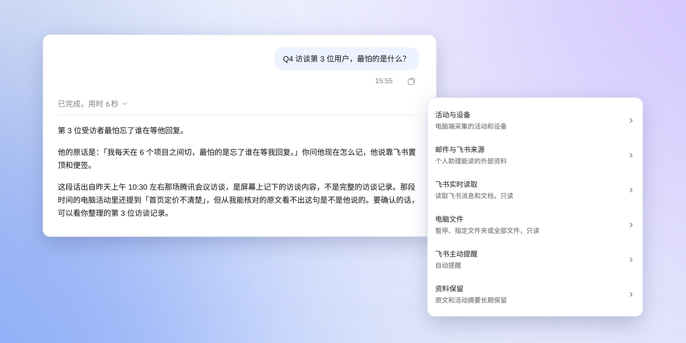

# DS-buddy：你的下一个 Agent 产品，不一定需要有 Agent

**探索人与 AI 的最佳协作方式**

[使用说明](https://dkkd13.github.io/tacit-dsh/site/blog/guide/) · [工程架构](https://dkkd13.github.io/tacit-dsh/site/blog/deep/) · [产品页](https://dkkd13.github.io/tacit-dsh/site/) · [演示片](https://github.com/DKKD13/tacit-dsh/releases/latest/download/tacit-film.mp4) · [English](README.en.md)

Agent 越来越能干，人的效率却没跟上。我们在好几个对话之间来回跑，搬运上下文，当胶水，很少有时间想清楚方向。

问题不在 AI 不够聪明，而在人和 AI 之间沟通的带宽太窄。上下文得交给 AI，又不能为此耗掉人的注意力。

很多 Agent 产品的答案是开更多 Agent：分角色，开会，互相传话。

我们的看法不同。

**大多数时候，你不需要多 Agent。** 管理 Agent，本质上是管理 context。fork 是共享，新分支天生带着主对话的全部上下文。多 Agent 是传递，要压缩、复述、再理解，每多一层就多一分损耗。人传话会走样，Agent 也一样。会议室式的多 Agent 看起来像协作，其实只是把人类的组织方式搬到了模型上。

只靠 fork 也不够。对话自然长出来的上下文会越来越脏：闲聊、过时的结论、中间过程的噪音都留在里面，一直消耗模型的注意力。只靠压缩救不回来。

**上下文要在一开始就设计好。** AI 需要明确的目标和验收标准，所以 DS-buddy 以 Goal（也就是 Loop）为核心来组织工作。你只用讲清三件事：要做什么，上下文在哪，标准是什么。AI 会把它拆成一个个任务，每个任务都有自己的上下文包，可以理解为一份 goal 文件。这份文件才是真正要长期维护的，每次注入，每次更新。适合交出去的任务不一定大，但必须完整，能独立交付。

负责执行的 Agent 只是工具。它们状态脆弱，用完就丢，下次重新注入就行。再配上定时重复运行的自动任务，你的任务循环就能自己转起来。

**细节藏起来，进度摆出来。** Multica 和 Raft 用群聊、工单来组织 Agent，底层抽象做得很好，我们也借鉴了它们的思路。但建频道、配角色、做分工，对人来说本身就是负担。上下文怎么组装、缓存在哪一层命中、token 怎么省，都是引擎盖下的事。藏得好还有实际回报：稳定的部分放在前面，模型就能复用上次读过的内容，而缓存命不命中，成本差一个数量级。

所以 DS-buddy 里没有要起名字的 Agent，也没有要配的技能。但每件事做到哪了、交给了哪个模型，都看得见。每个任务有一页详情，需要你拍板的事都在一块「待你决定」的看板上。


**它在你开口之前就懂。** AI 要接过搬运上下文的活，先得看到足够多的上下文。屏幕上正在做的事、飞书里的消息源源不断地进来，每 10 分钟整理成一条时间线。电脑里的文件，需要时再去读。全部只读，随时能关。



自动采集并不新鲜，Screenpipe、AirJelly、Littlebird，还有 Codex 内置的 Computer History 早就在做了。但它们大多停在收集上下文这一步，没有走到行动。

DS-buddy 的核心助理默认叫 Tacit，意思是默会、心领神会。好的 buddy 不需要你把话说全。

**一个小建议：用最强的模型来拆任务。** 现在最关键的一环是 coordinator，也就是负责拆任务的那个助理，它的分工和粒度定得合不合理。我们推荐用 Claude Opus 5.5 或 GPT-6 Astra 这样的强模型来当个人助理。随着模型越来越强、分工 skills 越磨越好，这件事会做得越来越好。

人只在关键的地方表达喜好、给出方向，不再当信息的搬运工。其余的交给 AI。

DS-buddy，你的下一个 Agent 产品，不一定需要有 Agent。

装上试试。

## 装上

需要 DeepSeek Harness（在 0.2.1 上测过）和 Node 24 以上。没装过 DeepSeek Harness 的话，先 `npm install -g @deepseek-ai/dsh`。

```sh
git clone https://github.com/DKKD13/tacit-dsh
cd tacit-dsh/plugin
dsh plugin --profile web add "$(pwd)"    # 把插件装进 DeepSeek Harness
dsh --profile web                        # 启动，在浏览器里打开它给的地址
```

打开后左边多出「个人助理」和「项目」，新建一个项目，说第一句目标就行。一步一步的说明见[使用说明](https://dkkd13.github.io/tacit-dsh/site/blog/guide/)。

## 文档

- [使用说明](https://dkkd13.github.io/tacit-dsh/site/blog/guide/)：怎么和 Tacit 一起工作
- [工程架构](https://dkkd13.github.io/tacit-dsh/site/blog/deep/)：它是怎么搭起来的
- [上手指南](docs/GETTING-STARTED.md)、[功能介绍](docs/FEATURES.md)、[测试报告](docs/TESTING.md)

## 现在到哪一步了

1.0 版。只能跑在 DeepSeek Harness 里，界面目前只有中文，飞书只读。Claude Code 当执行者实跑验证过；Codex 能选，但还没有验证到它跑完一个完整任务。这两者当执行者时不弹权限确认，也没有沙箱：你的系统用户能读写的，它都能读写。


许可证：[MIT](LICENSE)。
