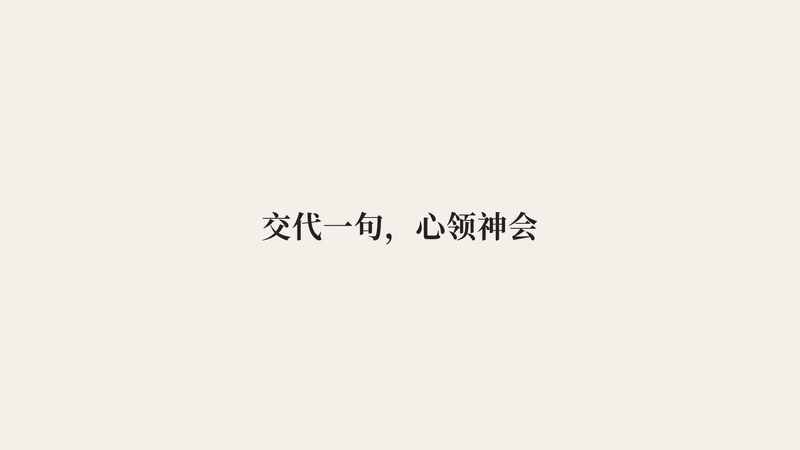
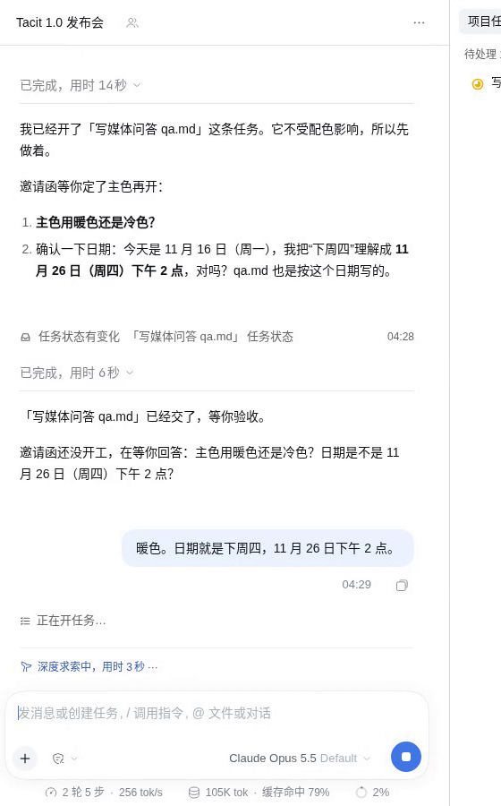
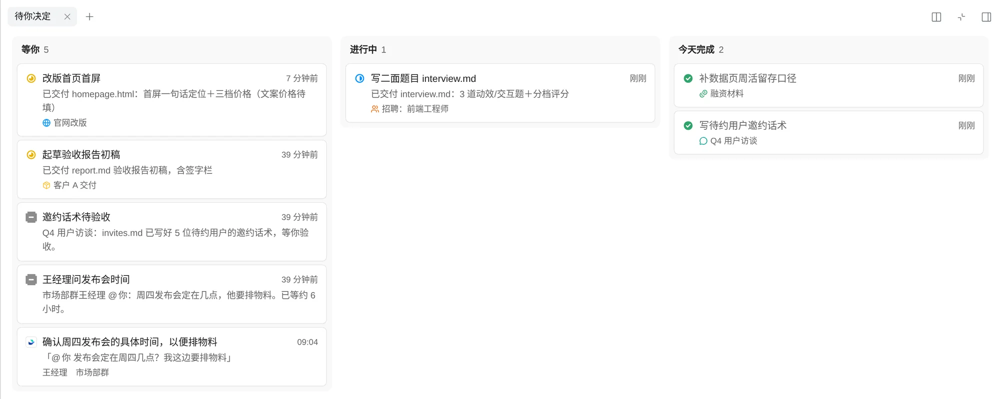

# Tacit

**只说目标，只管拍板。**

Tacit 是 [DeepSeek Harness](https://github.com/deepseek-ai/deepseek-harness) 的一个开源插件。你说一句目标，它把没说清的问清楚，拆成几个任务同时去做，做完把成品交到你面前。中间只有需要你做决定的时候，才来找你。

[产品页](https://dkkd13.github.io/tacit-dsh/site/) · [发布文](https://dkkd13.github.io/tacit-dsh/site/blog/) · [85 秒演示片](https://github.com/DKKD13/tacit-dsh/releases/latest/download/tacit-film.mp4) · [English](README.en.md)



## 一个例子

在项目里说一句：

> 下周四发布 Tacit 1.0，做一个网页邀请函和一份媒体问答。

接下来：

1. **它先问清楚。**「下周四」到底是哪天，邀请函用什么主色。不依赖答案的部分先开工。
2. **拆成任务，同时做。** 邀请函和媒体问答各是一个任务，各有一个执行者在做。
3. **要你定的，给你一张选项卡。** 推荐项标出来，都不合适就直接说。
4. **交回来的是成品。** 网页直接能看，文档直接能读。你看过点「验收通过」，这件事才算完。

| 1 先问清楚 | 2 你来定 |
| --- | --- |
|  |  |

| 3 做到哪一步，看得见 | 4 交回来的是成品 |
| --- | --- |
|  |  |

所有在等你的事，都在一块叫「待你决定」的看板上：



## 和别的 agent 工具有什么不一样

- **你看到的是任务，不是 agent。** 不用给 agent 起名字、配技能、盯着一屋子对话。每个任务后面有执行者在做，但你管的是事情。
- **你说过的话会跟着走。** 每个任务带着你的原话。它记住的关于你的事，每条都能点回你说那句话的地方。
- **不用守着。** 只有三种情况会来找你：要你拍板，等你验收，做不下去了。

## 装上

需要 DeepSeek Harness（在 0.2.1 上测过）和 Node 24 以上。没装过 DeepSeek Harness 的话，先 `npm install -g @deepseek-ai/dsh`。

```sh
git clone https://github.com/DKKD13/tacit-dsh
cd tacit-dsh/plugin
npm test                                 # 488 个单测，可以跳过
dsh plugin --profile web add "$(pwd)"    # 把插件装进 DeepSeek Harness
dsh --profile web                        # 启动，在浏览器里打开它给的地址
```

打开后左边多出「个人助理」和「项目」两项。新建一个项目，在项目对话里说第一句目标就行。模型用的是你在 DeepSeek Harness 里配好的那个。

一步一步的说明见 [上手指南](docs/GETTING-STARTED.md)，十分钟走完。

## 都有什么

- **待你决定。** 一块看板，三栏：等你、进行中、今天完成。点任务卡进任务，点消息卡把回复写进输入框。
- **任务详情。** 背景和你的原话、怎么算完成、读过的文件、按时间排的进展。想自己动手就点「我来接手」，做完再交还。
- **执行者可换。** 默认由 DeepSeek Harness 执行。机器上装了 Claude Code，就可以把任务换给它。Codex 也能选，但还没有验证到它跑完一个完整任务。
- **记忆有出处。**「关于你」只记你亲口说过的话，每条带原话，可以改，可以忘掉。
- **夜里想一轮。** 电脑空闲的夜里，个人助理把当天过一遍，早上最多留三件事给你，每件写明出处。
- **只读接入。** 飞书消息和你允许的 Mac 文件夹，都只读，随时能关。

每项功能学自谁、哪些测试在保它，见 [功能介绍](docs/FEATURES.md)。

## 它是怎么工作的

- 每个助理都是 DeepSeek Harness 里一个普通的会话，随时可以点开看它做了什么。
- 所有状态记在一条事件日志里。看板、任务详情、记忆都是从日志算出来的。
- 叫醒一个助理时只告诉它「有几条新消息、来自哪里」，内容由它自己去读。所以提醒丢了，消息也不会丢。
- 代码只做核对：引的原话是不是真在那条消息里，数字是不是来自材料。理解和措辞交给模型。

## 现在到哪一步了

- 1.0 版，MIT 许可证。488 项自动化测试，Linux 和 macOS 上都跑过。
- 只能跑在 DeepSeek Harness 里。界面目前只有中文。飞书只读。
- Claude Code 当执行者实跑验证过。Codex 的切换和启动试过，用它自己的模型跑完一个任务还没有验证到。
- Claude Code 和 Codex 当执行者时不弹权限确认，也没有沙箱：你的系统用户能读写的，它都能读写。
- 它不替你拍板，不替你验收，不以你的名义发消息。模型的密钥只留在运行它的机器上。

逐条的测试记录和没验到的部分，见 [测试报告](docs/TESTING.md)。

## 文档

- [上手指南](docs/GETTING-STARTED.md)
- [功能介绍](docs/FEATURES.md)
- [测试报告](docs/TESTING.md)
- [对标记录](docs/launch/benchmark.md)：Manus、Genspark、Raft 的官网和发布文怎么写，我们学了哪条


许可证：[MIT](LICENSE)。
