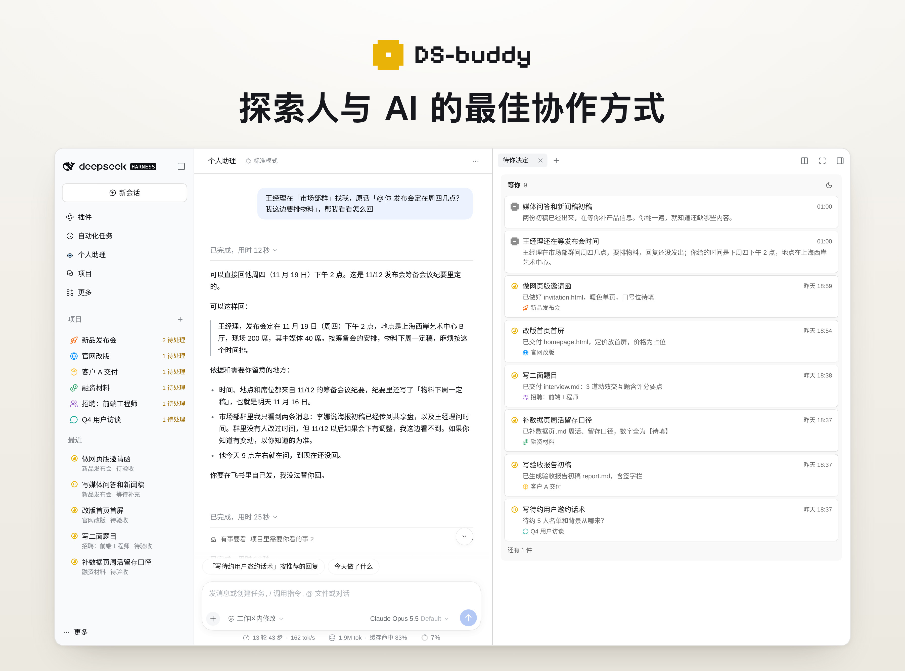
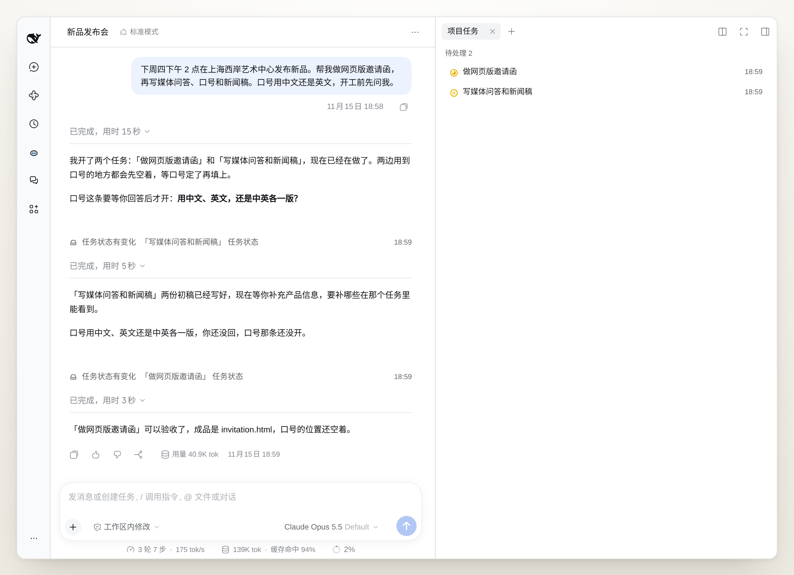
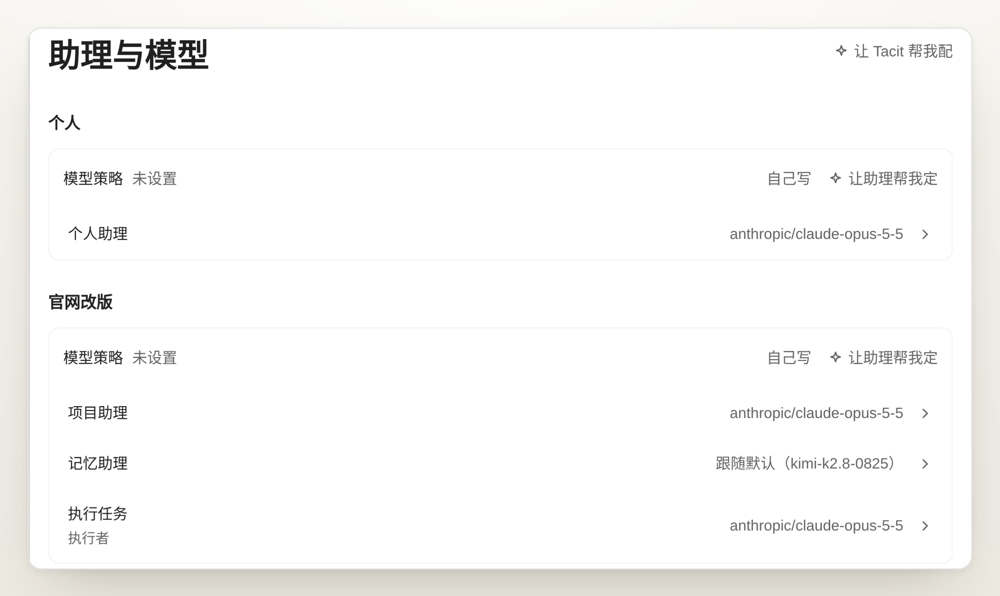
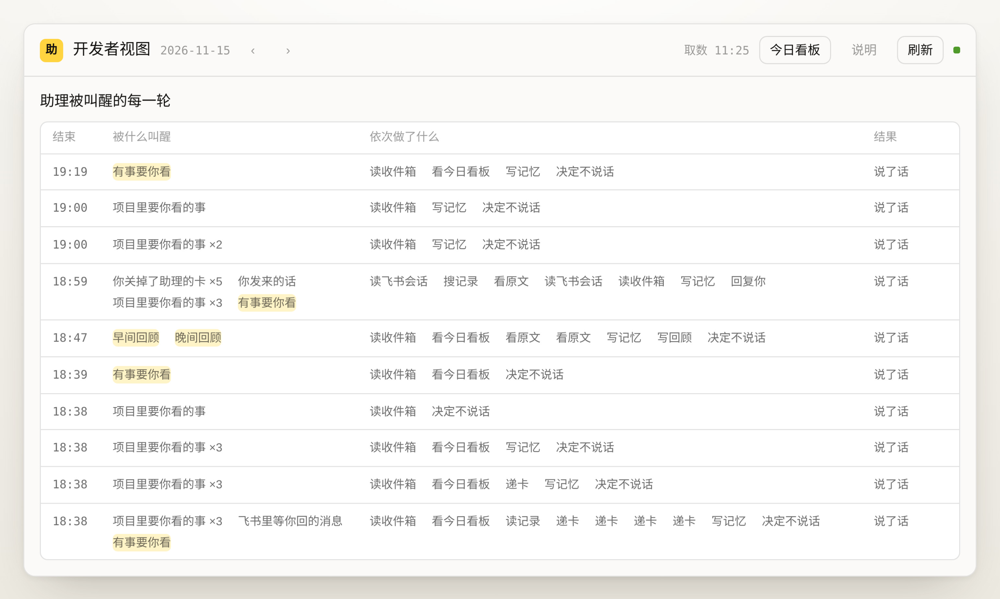
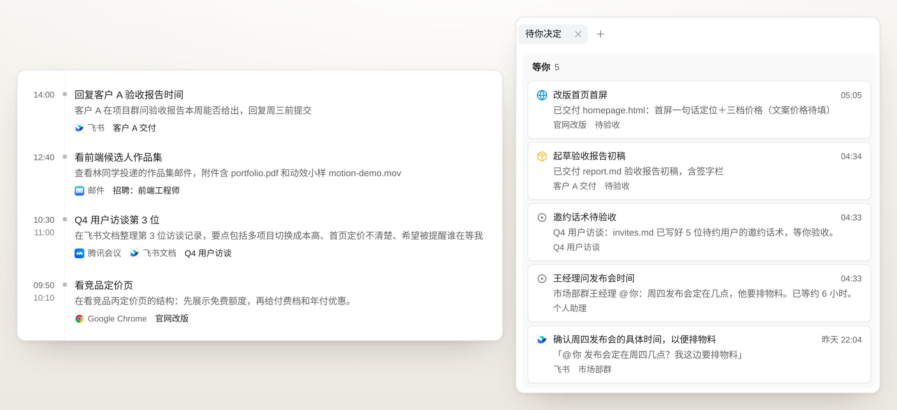

<p align="center"><a href="README.en.md">English</a></p>

最近半年，我越来越深刻地感受到一个痛点：Agent 越来越能干，但人的效率却没有同步跟上。同样的情景反复发生，我们在好几个对话之间来回跑，搬运上下文，当胶水，却牺牲了真正想清楚方向的时间。

问题不在 AI 不够聪明，而在人和 AI 之间沟通的带宽太窄。DS-buddy 希望塑造一种新的交互方式，降低人和 AI 之间沟通的摩擦。

**大多数时候，你不需要多 Agent。管理 Agent，本质上是管理 context。**

Agent 的概念不应该滥用，绝大多数时候，fork 已经能够很好地满足我们的需求。很多 Agent 产品把组织人的经验套在了 AI 身上：开越来越多的 Agent，配角色、建频道、传工单。看起来像协作，本质上还是在模拟人的会议室，希望通过人的模拟，来降低彼此沟通的成本。

**用好 AI 的关键，是可交付、可验证、可合成的结构。**

DS-buddy 有意识地让每一个 Agent 去维护每个任务的组织，同时提供自动任务（定时重复运行的任务），帮助你丝滑地构建自己的任务循环。对于每个核心 thread，我们都会为其设定一个稳定的上下文。



**我们不需要 Agent 的概念，要把 Agent 的 runtime 细节、动态破碎的状态都隐藏起来。**

DS-buddy 的开发理念认为，Agent 只需要暴露模型本身，多一层 Agent，就多一层负担。（有人会说，类似 Multica 这类产品的 Agent 需要配置 Skills、runtime，但这会增加用户配置的难度。）同时，这些都应该属于广义的任务 context 的一部分，不应该预设，而是在项目里随着任务的动态需求来变化。当然，我们也允许、也鼓励用户为每一个项目配置模型优先使用的项目规则。



**Agent 的抽象是不需要的，也不应该成为负担。**

但 DS-buddy 认为，抽象之外，仍然应该给到每一个 runtime 足够的观测。



**最大化 context 的吸收，使用最好的模型进行任务的分配，尽情让 AI 去探索。**

DS-buddy 最大限度地相信：给足模型 context，然后相信它自由地探索，胜过过度的 prompt 设计。



一个温馨的小 tips：建议使用尽可能高质量的模型，作为个人助理的模型配置。

## 装上

需要 DeepSeek Harness（在 0.2.1 上测过）和 Node 24 以上。没装过 DeepSeek Harness 的话，先 `npm install -g @deepseek-ai/dsh`。

```sh
git clone https://github.com/DKKD13/tacit-dsh
cd tacit-dsh/plugin
dsh plugin --profile web add "$(pwd)"    # 把插件装进 DeepSeek Harness
dsh --profile web                        # 启动，在浏览器里打开它给的地址
```

打开后左边多出「个人助理」和「项目」，新建一个项目，说第一句目标就行。一步一步的说明见[使用说明](https://dkkd13.github.io/tacit-dsh/site/blog/guide/)。

## 详细内容

- [介绍（完整版）](https://dkkd13.github.io/tacit-dsh/site/blog/)：这篇介绍的长版本
- [使用说明](https://dkkd13.github.io/tacit-dsh/site/blog/guide/)：怎么和 Tacit 一起工作
- [工程架构](https://dkkd13.github.io/tacit-dsh/site/blog/deep/)：它是怎么搭起来的
- [产品页](https://dkkd13.github.io/tacit-dsh/site/)、[演示片](https://github.com/DKKD13/tacit-dsh/releases/latest/download/tacit-film.mp4)
- [上手指南](docs/GETTING-STARTED.md)、[功能介绍](docs/FEATURES.md)、[测试报告](docs/TESTING.md)

## 现在到哪一步了

1.0 版。只能跑在 DeepSeek Harness 里，界面目前只有中文，飞书只读。Claude Code 当执行者实跑验证过；Codex 能选，但还没有验证到它跑完一个完整任务。这两者当执行者时不弹权限确认，也没有沙箱：你的系统用户能读写的，它都能读写。


许可证：[MIT](LICENSE)。
