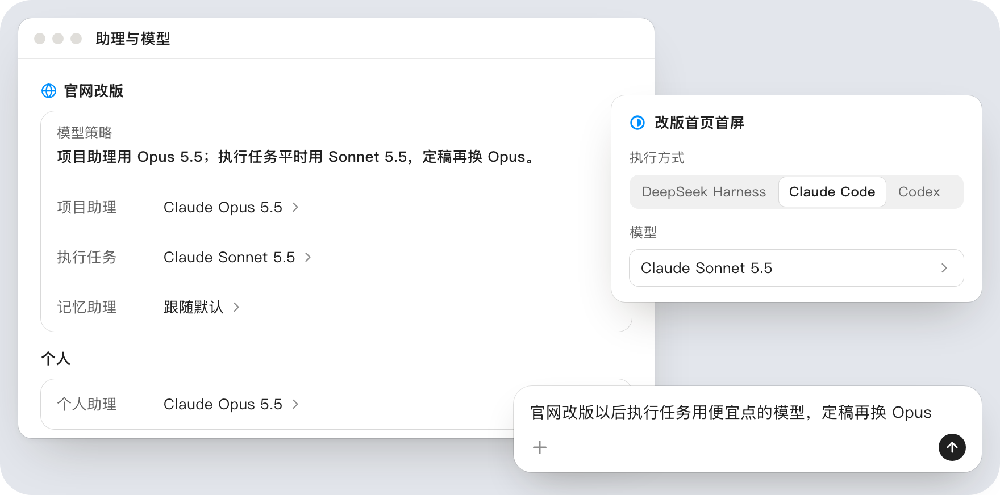
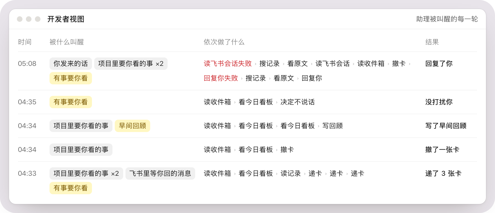

<h1 align="center">DS-buddy</h1>

<p align="center">探索人与 AI 的最佳协作方式</p>

<p align="center"><a href="README.en.md">English</a></p>


最近半年，我越来越频繁地陷入同一种疲惫：模型明明越来越强，我自己的产出却没有跟上。每天大量的精力，都耗在了几个对话窗口之间的来回切换上——把这一边的输出复制过去，把那一边漏掉的背景补齐。不知不觉中，我成了 AI 之间的胶水，反而没有时间停下来想清楚方向。

问题大概不在于 AI 不够聪明，而在于人和 AI 之间沟通的带宽太窄。我想做 DS-buddy，就是为了试探一种新的交互方式，把这种沟通的摩擦降下来。

**大多数时候，你不需要多 Agent。管理 Agent，本质上是管理 context。**

现在很多产品喜欢把人类团队的组织方式直接套在 AI 身上：开一堆 Agent，配角色、建频道、传工单。看起来热闹，但本质上还是在模拟人的会议室，试图用人类社会的分工来掩盖上下文的割裂。但在模型面前，fork 是共享，多 Agent 是传递。只要信息还在传递，就会有损耗。与其让几个 Agent 互相发消息，不如在一个完整的上下文里直接 fork 出子任务——绝大多数时候，这已经足够解决复杂问题了。

**用好 AI 的关键，是把任务拆成可验证、目标明确的结构，也就是一个个 goal 和循环。**

既然不需要靠角色扮演来分工，真正需要维护的其实是任务本身的结构。在 DS-buddy 里，我让助理去维护一套任务文件（goal）：目标是什么、怎么才算完成、依赖的上下文在哪，都明明白白地落在字面上。每个核心 thread 都对应一份稳定的上下文；再配合定时运行的自动任务，很多日常工作就能自然地跑成一个持续运转的循环，不需要人一直盯着。

**我们不需要 Agent 这个概念。runtime 的细节、动态破碎的状态，都应该藏起来。**

顺着这个思路往下走，我甚至觉得“Agent”本身都是一个多余的中间层。在类似 Multica 这样的产品里，用户需要先给 Agent 配置各种 Skills 和 runtime，这其实是在还没开始干活前，就逼着人去做繁琐的预设。但在我看来，工具和环境都只是广义的任务 context，应该在项目推进的过程中按需长出来，而不是提前框死。所以在 DS-buddy 里，我把破碎的运行状态都藏在了底下，只向你暴露模型本身。多一层 Agent 的概念，往往就多一层心智负担。你唯一需要操心的，大概就是为每个项目写一句“优先使用什么模型”的偏好。

**Agent 的抽象可以不要，但每个 runtime 都应该看得见。**

藏起复杂概念，不代表要把系统做成黑盒。当任务在后台自己跑起来的时候，人心里是很需要底气的。所以在拿掉 Agent 这层抽象的同时，DS-buddy 给底层的每一次运行都留了足够清晰的观测面板：助理是什么时候被什么事件叫醒的、依次调了什么工具、最终结果如何，随时都能在开发者视图里翻出来看个明白。

**最大化地吸收 context，用最好的模型分配任务，然后尽情让 AI 去探索。**

做这款产品的过程，也是我慢慢放下“控制欲”的过程。我越来越相信：给足模型 context，相信它自由地探索，往往胜过人类去过度设计精巧的 prompt。DS-buddy 会把你在电脑上做过的事整理成一条时间线，作为背景喂给模型；而模型在探索过程中遇到拿不准的主意，则会汇总到一块“待你决定”的看板上。你只需要在关键节点拍板，剩下的路让它自己走。

**一个小建议：用尽可能好的模型当个人助理。**

在这套机制里，个人助理（coordinator）干的是最吃判断力的活：理解你的意图，把模糊的想法拆成合理的任务粒度。如果第一步拆歪了，后面执行得再快也没用。所以我的经验是，尽量给个人助理配你能用上的最高质量的模型，比如 Claude Opus 5.5 或 GPT-6 Astra。把好钢用在刀刃上，体验会顺畅很多。

## 使用说明

### 1. 装上

需要 DeepSeek Harness（在 0.2.1 上测过）和 Node 24 以上。没装过 DeepSeek Harness 的话，先 `npm install -g @deepseek-ai/dsh`。

```sh
git clone https://github.com/DKKD13/tacit-dsh
cd tacit-dsh/plugin
dsh plugin --profile web add "$(pwd)"    # 把插件装进 DeepSeek Harness
dsh --profile web                        # 启动，在浏览器里打开它给的地址
```

打开后左边多出「个人助理」和「项目」。个人助理默认叫 Tacit，它看着所有项目。装了 Claude Code 或 Codex 的命令行，任务就能换给它们执行；装了飞书命令行（lark-cli）并授权，Tacit 能只读你的飞书消息。

### 2. 交代一件事

新建一个项目，可以给它一个文件夹，执行者会在里面干活。在项目对话里说一句话，讲清三件事：要做什么，上下文在哪，标准是什么。项目助理会先开工能开的，再问你没说清的，就像最上面那张图。

点开一个任务，能看到这件事的上下文：你的原话，怎么算完成，产出，读过的文件，进展。

### 3. 验收和拍板

做完的任务、飞书里等你回的消息、Tacit 自己的建议，都会出现在「待你决定」里。在装了 Screenpipe 的电脑上，屏幕上做过的事每 10 分钟整理成一条时间线，认得出项目的归到项目。


卡片上没有按钮。点任务卡打开任务，交付的网页、图片、文档都能直接预览，满意就验收，要改就写清楚改什么。点消息卡，一句完整的请求会写进输入框，你改完再发。

### 4. 模型和执行者

给项目写一句模型策略，自己写，或者直接对 Tacit 说。每个任务可以在 DeepSeek Harness、Claude Code、Codex 之间换执行者，模型也能单独换。



Claude Code 和 Codex 当执行者时不弹权限确认，也没有沙箱，你这个系统用户能读写的，它都能读写。

### 5. 每一轮都看得见

「开发者视图」里有助理被叫醒的每一轮：被什么叫醒，依次做了什么，哪一步失败了，最后结果如何。



### 你可以对 Tacit 说

| 你说 | 它做什么 |
| --- | --- |
| 「帮我建个项目：招聘前端工程师」 | 新建一个项目 |
| 「把这件事交给招聘那个项目：……」 | 把你的原话原样交给项目，开成任务 |
| 「还有什么在等我？」「今天做了什么？」 | 读看板和时间线回答，每条带出处 |
| 「跟二面题目那个任务说，再加一道 CSS 的题」 | 给这个任务带话 |
| 「验收吧」 | 先告诉你改了什么，等你回「确认」再验收 |
| 「记住：我看东西习惯先看结论」 | 记进「关于你」，带着原话 |
| 「这个项目以后用便宜点的模型」 | 记成项目的模型策略，再按策略换模型 |

它不以你的名义发消息。没有你的一句话，它不拍板，也不验收。

### 出问题时

| 现象 | 怎么办 |
| --- | --- |
| 页面显示「连不上服务，正在重连…」 | 服务停了或在重启。等它回来，页面会自己连上。 |
| 任务停在「失败」 | 打开任务看最后一条进展，多半是模型或网络错误，对它说「接着做」。 |
| 换成 Codex 后没动静 | Codex 需要在这台机器上自己登录过。 |

## 详细内容

- [介绍（完整版）](https://dkkd13.github.io/tacit-dsh/site/blog/)：这篇介绍的长版本
- [工程架构](https://dkkd13.github.io/tacit-dsh/site/blog/deep/)：它是怎么搭起来的
- [产品页](https://dkkd13.github.io/tacit-dsh/site/)、[演示片](https://github.com/DKKD13/tacit-dsh/releases/latest/download/tacit-film.mp4)
- [上手指南](docs/GETTING-STARTED.md)、[功能介绍](docs/FEATURES.md)、[测试报告](docs/TESTING.md)

## 现在到哪一步了

1.0 版。只能跑在 DeepSeek Harness 里，界面目前只有中文，飞书只读。Claude Code 当执行者实跑验证过；Codex 能选，但还没有验证到它跑完一个完整任务。这两者当执行者时不弹权限确认，也没有沙箱：你的系统用户能读写的，它都能读写。


许可证：[MIT](LICENSE)。
