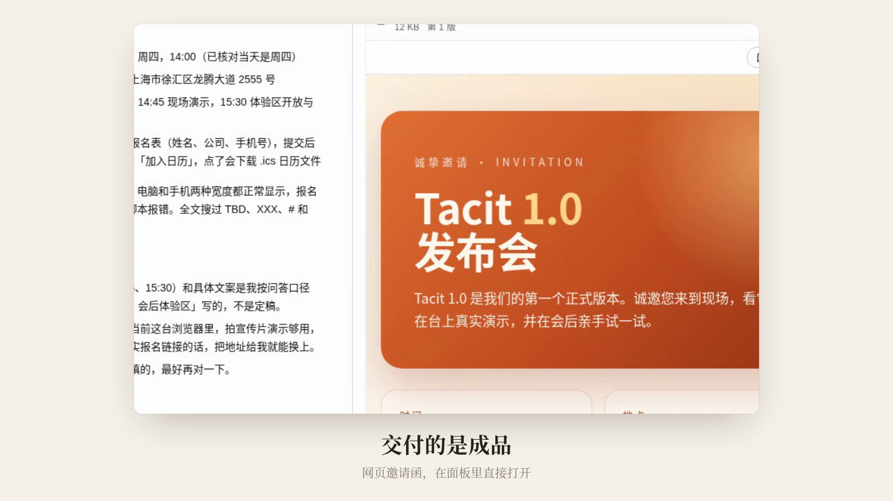
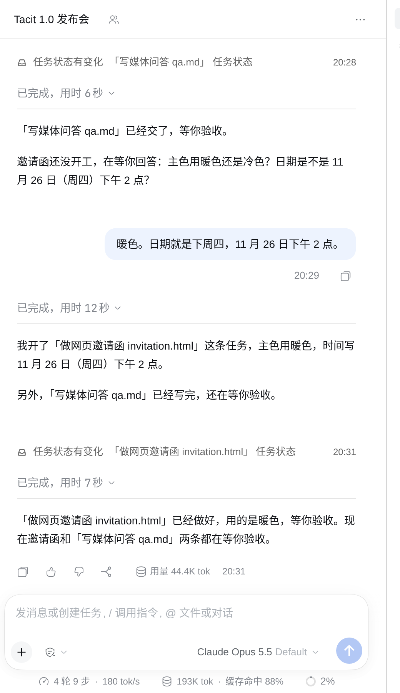
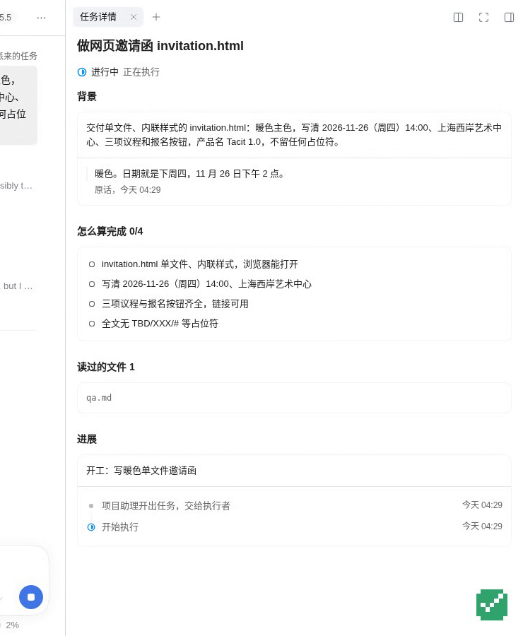
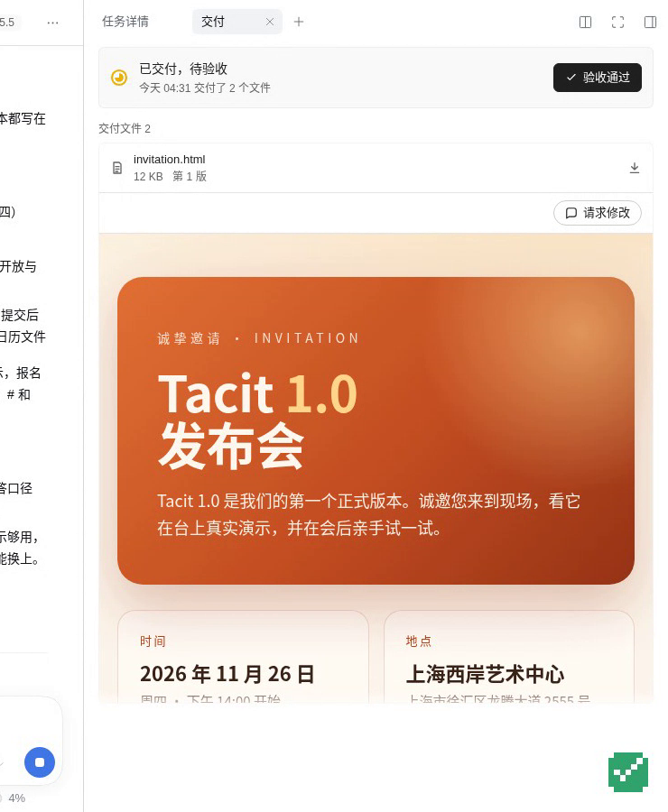

# Tacit

**交代一句，心领神会。**

Tacit 是跑在 DeepSeek Harness（DSH）里的一套上下文方案：把散在对话、项目、飞书和电脑里的东西重新组织，让每个 agent 拿到的正好是它需要的那一份。这样你只交代一句，它就懂；你只管拍板，事情就办成。

Tacit is a context layer for DeepSeek Harness. It reorganizes what is scattered across your chats, projects, Feishu and computer, so every agent gets exactly the context it needs. Say one sentence, and it gets it.

[English](README.en.md)





演示片（63 秒，真实界面，演示数据）：[`https://github.com/DKKD13/tacit-dsh/releases/latest/download/tacit-film.mp4`](https://github.com/DKKD13/tacit-dsh/releases/latest/download/tacit-film.mp4)

## 它是什么

- 右下角的**桌宠**是一个像素方块：颜色和图案表示助理此刻在做事、在等你还是做完了，⌥M 随时叫出来问一句。
- 一个**个人助理**看着你所有的项目，记得你亲口说过的话，有事等你时提醒你。
- 每个**项目**有一位项目助理：你说一件事，它先问清楚，再开出任务交给执行者；能并行的就并行。
- **执行者**真的动手：写文档、做网页、改代码，做完把成品发到项目的共享文件里，等你验收。

## 一件事怎么走完

| 1 先问清楚 | 2 你来定 |
| --- | --- |
|  |  |
| 你说「下周四发布 Tacit 1.0，做邀请函和媒体问答」，它先开工能开的，再问你主色、确认日期到底是哪天。 | 执行者需要你拍板时给一张选项卡片，推荐项标出来；都不合适就直接说。 |

| 3 做到哪一步，看得见 | 4 交付的是成品 |
| --- | --- |
|  |  |
| 任务详情：背景和你的原话、产出、读过的文件、按时间排的进展、用什么执行。 | 交付面板里，网页直接渲染、图片直接显示、文档直接预览；看过点「验收通过」。 |

## 功能

- **待你决定**：一块看板，分「等你 / 进行中 / 今天完成」三栏。要你拍板、待验收、执行失败的任务，飞书里等你回的消息，助理的提醒，都在「等你」里；点任务卡打开任务，点消息卡把回复填进输入框，由你改完再发。
- **夜里想一轮**：夜里电脑空闲时，个人助理单独想一轮，早上把几件可开的任务、值得看的东西和提醒放进「等你」，每件都带出处；还写一页日记。
- **任务详情**：背景、产出、读过的文件、进展时间线、执行方式和模型；可以「我来接手」，做完再交还。
- **拍板与验收**：选项卡片、「验收通过」按钮，关键的事始终由你决定。
- **执行方式**：每个任务默认用 DSH 执行；机器上装了 Claude Code 或 Codex 时可以换成它们，模型也可以单独换。换了以后，在任务原来的对话里输入的话会转给新的执行者。Claude Code 实跑验证过；Codex 的接入有单测，切换和启动也试过，但还没有验证到它用自己的模型跑完一个完整任务，见 [测试报告](docs/TESTING.md)。这两个执行者都不弹权限确认、没有沙箱，你的系统用户能读写的它都能读写。
- **助理与模型**：每个助理一页，写清什么时候醒、每轮读到什么、用什么模型；每个项目可以用一句话写模型策略，或者让个人助理替你配。
- **记忆**：「关于你」只记你亲口说的话，每条带原话、可撤销；「工作」记忆每条带依据。
- **随手问与桌宠**：像素方块表示助理现在的状态，⌥M 随时叫出来问一句。
- **只读接入**：飞书消息实时读取（只读）、Mac 上指定文件夹的读取，都可以随时关掉。

## 快速开始

需要 DSH 0.2.x 的 Web profile 和 Node 24 以上。

```sh
cd plugin && npm test                  # 484 个单测
bash scripts/install-mac.sh            # Mac：把插件装进 DSH 并启动一个试用的 DSH（profile mira-qa，端口 18180）
```

也可以直接把插件目录加进自己的 DSH：

```sh
dsh plugin --profile web add /path/to/tacit-dsh/plugin
dsh --profile web
```

打开后左侧导航多出「个人助理」和「项目」。模型跟着 DSH 的配置走；要换成别的 OpenAI 兼容网关，照 `plugin/qa/provider-template.yml` 加到 profile 的 `cordis.patch.yml`。

## 工作原理

- 每个助理都是一个普通的 DSH 会话：项目助理、记忆助理各一个，执行者每个任务一个。随时可以打开看完整轨迹。
- 唤醒只带「几条未读、来自哪里」，正文由助理自己读收件箱，回合结束才确认，所以唤醒丢了不丢消息。
- 所有状态是一条事件日志；界面、任务详情、记忆都从日志算出来。
- 代码只做校验：引用的东西是否存在、原话是否真的在那条消息里、数字是否来自材料；理解和措辞交给模型。

## 边界

- 不替你拍板，不替你验收，不以你的名义发消息。
- 飞书只读；Mac 文件夹只读，而且只读你允许的几个。
- 模型的 key 只放在运行它的机器上，不进仓库。

## 文档

- 产品页：[`docs/site/index.html`](docs/site/index.html)（中英可切换，可以直接用 GitHub Pages 托管）
- 上手：[`docs/GETTING-STARTED.md`](docs/GETTING-STARTED.md)
- 核心功能和依据：[`docs/FEATURES.md`](docs/FEATURES.md)
- 测试报告：[`docs/TESTING.md`](docs/TESTING.md)
- 对标 Manus、Genspark、Raft 的记录：[`docs/launch/benchmark.md`](docs/launch/benchmark.md)


许可证：[MIT](LICENSE)。
