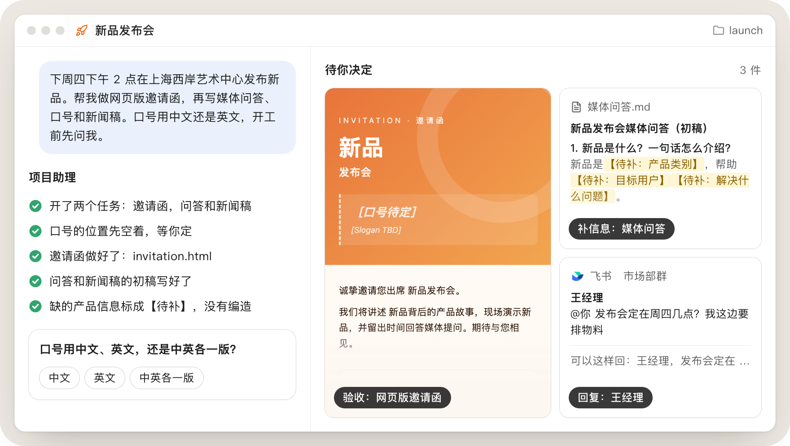
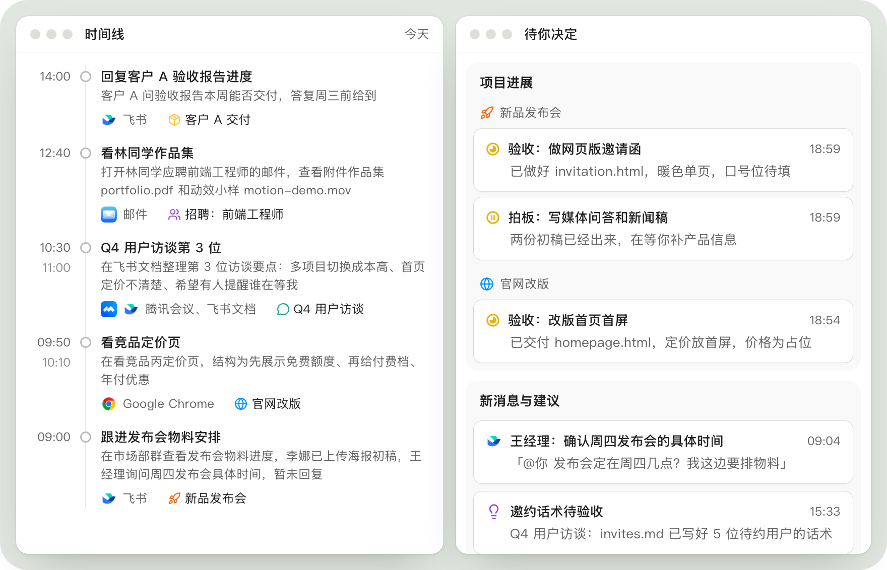

<h1 align="center">DS-buddy</h1>

<p align="center">探索人与 AI 的最佳协作方式</p>

<p align="center"><a href="README.en.md">English</a></p>



最近半年，我越来越深刻地感受到一个痛点：Agent 越来越能干，人的效率却没有同步跟上。同样的情景反复发生：我们在好几个对话之间来回跑，搬运上下文，当胶水，却牺牲了真正想清楚方向的时间。

问题不在 AI 不够聪明，而在人和 AI 之间沟通的带宽太窄。DS-buddy 想塑造一种新的交互方式，降低人和 AI 之间沟通的摩擦。

**大多数时候，你不需要多 Agent。管理 Agent，本质上是管理 context。**

Agent 的概念不应该被滥用，绝大多数时候，fork 已经能很好地满足需求。很多 Agent 产品把组织人的经验套在了 AI 身上：开越来越多的 Agent，配角色、建频道、传工单。看起来像协作，本质上还是在模拟人的会议室，想靠模拟人来降低彼此沟通的成本。

**用好 AI 的关键，是把任务拆成可以验证、目标明确的结构，也就是一个一个 goal 和循环。**

DS-buddy 有意识地让 Agent 去维护每个任务的组织：目标是什么、怎么算完成、上下文在哪，都写在任务里。再配上定时重复运行的自动任务，你就能丝滑地搭起自己的任务循环。每个核心 thread，都有一份稳定的上下文。

**我们不需要 Agent 这个概念。runtime 的细节、动态破碎的状态，都应该藏起来。**

DS-buddy 的开发理念是：Agent 只需要暴露模型本身，多一层 Agent，就多一层负担。有人会说，像 Multica 这样的产品，Agent 需要配置 Skills 和 runtime，但这会增加用户配置的难度。这些其实都属于广义的任务 context，不应该预设，而应该在项目里随着任务的需要变化。当然，我们也允许、也鼓励你为每个项目写一条模型优先使用的规则。

**Agent 的抽象可以不要，但每个 runtime 都应该看得见。**

抽象不应该成为负担。不过在抽象之外，DS-buddy 仍然给每一个 runtime 留了足够的观测：被什么叫醒、依次做了什么、结果如何，都能在开发者视图里查到。

**最大化地吸收 context，用最好的模型分配任务，然后尽情让 AI 去探索。**

DS-buddy 最大限度地相信：给足模型 context，再相信它自由地探索，胜过过度地设计 prompt。屏幕上做过的事会整理成一条时间线，需要你决定的事都在一块看板上。

**一个小建议：用尽可能好的模型当个人助理。**

拆任务的是助理，也就是 coordinator。任务分得合不合理、粒度定得对不对，决定了后面执行得顺不顺。所以我们建议给个人助理配尽可能高质量的模型，比如 Claude Opus 5.5 或 GPT-6 Astra。

## 使用说明

### 1. 装上

需要 DeepSeek Harness（在 0.2.1 上测过）和 Node 24 以上。没装过 DeepSeek Harness 的话，先 `npm install -g @deepseek-ai/dsh`。

```sh
git clone https://github.com/DKKD13/tacit-dsh
cd tacit-dsh/plugin
dsh plugin --profile web add "$(pwd)"    # 把插件装进 DeepSeek Harness
dsh --profile web                        # 启动，在浏览器里打开它给的地址
```

打开后左边多出「个人助理」和「项目」。个人助理默认叫 Tacit，它看着所有项目。装了 Claude Code 或 Codex 的命令行，任务就能换给它们执行；装了飞书命令行（lark-cli）并授权，Tacit 能只读你的飞书消息。

### 2. 交代一件事

新建一个项目，可以给它一个文件夹，执行者会在里面干活。在项目对话里说一句话，讲清三件事：要做什么，上下文在哪，标准是什么。项目助理会先开工能开的，再问你没说清的，就像最上面那张图。

点开一个任务，能看到这件事的上下文：你的原话，怎么算完成，产出，读过的文件，进展。

### 3. 验收和拍板

做完的任务、飞书里等你回的消息、Tacit 自己的建议，都会出现在「待你决定」里。在装了 Screenpipe 的电脑上，屏幕上做过的事每 10 分钟整理成一条时间线，认得出项目的归到项目。



卡片上没有按钮。点任务卡打开任务，交付的网页、图片、文档都能直接预览，满意就验收，要改就写清楚改什么。点消息卡，一句完整的请求会写进输入框，你改完再发。

### 4. 模型和执行者

给项目写一句模型策略，自己写，或者直接对 Tacit 说。每个任务可以在 DeepSeek Harness、Claude Code、Codex 之间换执行者，模型也能单独换。


Claude Code 和 Codex 当执行者时不弹权限确认，也没有沙箱，你这个系统用户能读写的，它都能读写。

### 5. 每一轮都看得见

「开发者视图」里有助理被叫醒的每一轮：被什么叫醒，依次做了什么，哪一步失败了，最后结果如何。


### 你可以对 Tacit 说

| 你说 | 它做什么 |
| --- | --- |
| 「帮我建个项目：招聘前端工程师」 | 新建一个项目 |
| 「把这件事交给招聘那个项目：……」 | 把你的原话原样交给项目，开成任务 |
| 「还有什么在等我？」「今天做了什么？」 | 读看板和时间线回答，每条带出处 |
| 「跟二面题目那个任务说，再加一道 CSS 的题」 | 给这个任务带话 |
| 「验收吧」 | 先告诉你改了什么，等你回「确认」再验收 |
| 「记住：我看东西习惯先看结论」 | 记进「关于你」，带着原话 |
| 「这个项目以后用便宜点的模型」 | 记成项目的模型策略，再按策略换模型 |

它不以你的名义发消息。没有你的一句话，它不拍板，也不验收。

### 出问题时

| 现象 | 怎么办 |
| --- | --- |
| 页面显示「连不上服务，正在重连…」 | 服务停了或在重启。等它回来，页面会自己连上。 |
| 任务停在「失败」 | 打开任务看最后一条进展，多半是模型或网络错误，对它说「接着做」。 |
| 换成 Codex 后没动静 | Codex 需要在这台机器上自己登录过。 |

## 详细内容

- [介绍（完整版）](https://dkkd13.github.io/tacit-dsh/site/blog/)：这篇介绍的长版本
- [工程架构](https://dkkd13.github.io/tacit-dsh/site/blog/deep/)：它是怎么搭起来的
- [产品页](https://dkkd13.github.io/tacit-dsh/site/)、[演示片](https://github.com/DKKD13/tacit-dsh/releases/latest/download/tacit-film.mp4)
- [上手指南](docs/GETTING-STARTED.md)、[功能介绍](docs/FEATURES.md)、[测试报告](docs/TESTING.md)

## 现在到哪一步了

1.0 版。只能跑在 DeepSeek Harness 里，界面目前只有中文，飞书只读。Claude Code 当执行者实跑验证过；Codex 能选，但还没有验证到它跑完一个完整任务。这两者当执行者时不弹权限确认，也没有沙箱：你的系统用户能读写的，它都能读写。


许可证：[MIT](LICENSE)。
